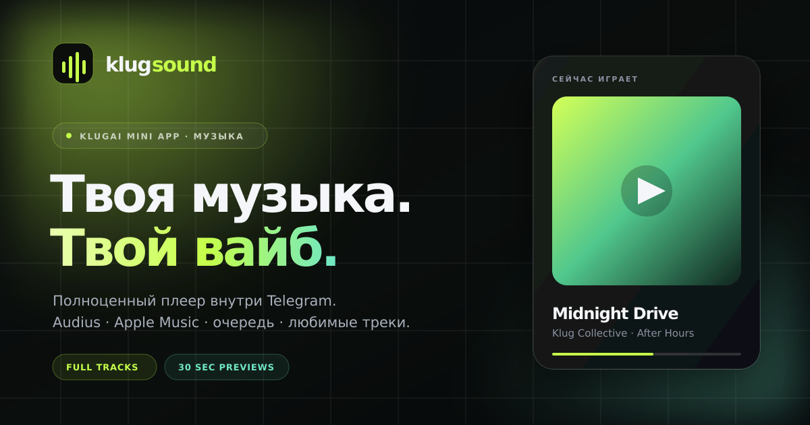

# KLUG Sound

Музыкальный мини-апп для Telegram: лендинг, поиск по двум каталогам, страницы исполнителей, плейлисты, полный плеер с очередью, любимыми треками и историей прослушиваний.

Проект полностью статический: HTML, CSS и vanilla ES-модули. Нет сборки, сервера, API-ключей и базы данных. Поэтому его можно бесплатно разместить на GitHub Pages и открыть как Telegram Mini App.



## Что внутри

- **Лендинг** `index.html` — презентация проекта, возможностей и источников музыки, кнопка перехода в плеер.
- **Плеер** `player.html` — SPA с hash-роутингом:
  - главная с трендами Audius, подборками и исполнителями;
  - поиск с объединением результатов Audius и Apple Music;
  - страницы исполнителей и плейлистов;
  - библиотека, любимые треки и история;
  - очередь, shuffle, repeat (off / all / one), seek, громкость и mute;
  - полноэкранный режим «Сейчас играет», Media Session API и горячие клавиши;
  - адаптивная мобильная версия с учётом safe-area.
- **PWA** — `manifest.webmanifest`, service worker `sw.js`, иконки и `404.html`.
- **Контекст проекта** — `PROJECT_CONTEXT.md`: архитектура, API, роуты, ограничения и интеграция с KlugAI.

## Источники музыки

> **Новый главный источник: YouTube через yt-dlp** (локальный бэкенд `backend/server.py`) — находит русских исполнителей (включая Мэйби Бэйби) и отдаёт полные треки. Запуск: `python3 backend/server.py` (порт 8799). Мини-апп автоматически использует его, если он доступен; иначе остаются Audius / Apple Music / Deezer.

| Источник | Что даёт | Ограничение |
|---|---|---|
| [YouTube](https://youtube.com) (через yt-dlp) | Полные треки и артисты, включая русских | Нужен локальный бэкенд `backend/server.py` |
| [Audius](https://audius.co) | Полные треки, исполнители, плейлисты, тренды | Каталог инди/электроники; часть треков может быть удалена |
| [iTunes Search API](https://performance-partners.apple.com/search-api) | Мировые хиты, обложки, артисты, 30-сек. превью Apple Music | Только 30-секундные превью Apple Music |
| [Deezer](https://www.deezer.com) | Полные треки и артисты | Через браузер сейчас блокируется CORS; код готов к использованию с прокси |

Оба доступных API не требуют ключей и отдают CORS-заголовки, поэтому работают напрямую из браузера. Медиа не хранится и не раздаётся проектом: плеер воспроизводит поток напрямую с CDN Audius / Apple Music.

### Оригиналы и ремиксы

- Поиск по умолчанию показывает оригинальные версии; ремиксы (mix/remix/cover/bootleg/acoustic/live и подобные) скрыты.
- Переключатель «Показать ремиксы» доступен в результатах поиска.
- Артисты без треков в Audius получают fallback-поиск треков по имени (пример: MORGENSHTERN → Audius `bgRdX`).

## Локальный запуск

Проекту нужен HTTP-сервер: ES-модули и `fetch` не работают через `file://`.

```bash
cd /home/lexoffpls/bot/mini-app
python3 -m http.server 8080
```

Открой:

- лендинг — <http://127.0.0.1:8080/>
- плеер — <http://127.0.0.1:8080/player.html>

Любой другой статический сервер тоже подойдёт, например `npx serve` или расширение Live Server.

## Деплой на GitHub Pages

1. Создай репозиторий и загрузи содержимое папки `mini-app` в корень ветки `main`.
2. В GitHub открой **Settings → Pages**.
3. В **Build and deployment** выбери **Deploy from a branch**, ветку `main` и папку `/ (root)`.
4. Сохрани и дождись публикации по адресу вида `https://USERNAME.github.io/REPO/`.

В проекте уже есть `.nojekyll` (папка с точкой), все пути относительные, а навигация использует hash-роуты — GitHub Pages не нужны серверные редиректы.

### После деплоя

- Проверь, что открывается `https://USERNAME.github.io/REPO/player.html`.
- Замени относительные `og:image` / `og:url` на абсолютные URL страницы — Telegram и соцсети не всегда разрешают относительные пути в Open Graph.
- Если менял файлы, подними версию кэша в `sw.js` (`VERSION = "klug-sound-v2"`), чтобы пользователи получили обновление.
- Для PWA и service worker нужен HTTPS. GitHub Pages включает его автоматически.

## Telegram Mini App

### Вариант 1. BotFather

1. Открой `@BotFather` → `/mybots` → выбери бота.
2. **Bot Settings → Menu Button → Configure menu button**.
3. Укажи URL опубликованного приложения, например `https://USERNAME.github.io/REPO/player.html`.
4. Название кнопки: `Музыка` или `KLUG Sound`.

### Вариант 2. Bot API / aiogram

```python
from aiogram import Bot
from aiogram.types import MenuButtonWebApp, WebAppInfo

WEBAPP_URL = "https://USERNAME.github.io/REPO/player.html"

await bot.set_chat_menu_button(
    chat_id=user_id,
    menu_button=MenuButtonWebApp(
        text="Музыка",
        web_app=WebAppInfo(url=WEBAPP_URL),
    ),
)
```

Для кнопки внутри сообщения:

```python
from aiogram.types import InlineKeyboardButton, InlineKeyboardMarkup

keyboard = InlineKeyboardMarkup(
    inline_keyboard=[[
        InlineKeyboardButton(text="Открыть KLUG Sound", web_app=WebAppInfo(url=WEBAPP_URL))
    ]]
)
```

Страницы уже подключают `telegram-web-app.js` и вызывают `ready()`, `expand()`, настраивают цвета, BackButton, haptics и отключают вертикальные свайпы (с защитой от старых версий Telegram).

> Приложение не отправляет `initData` на сервер и не требует авторизации: имя пользователя из Telegram используется только для отображения в интерфейсе. Если позже появятся серверные функции, `initData` нужно проверять на бэкенде по подписи — доверять `initDataUnsafe` нельзя.

## Структура

```text
mini-app/
├── index.html              # лендинг
├── player.html             # оболочка плеера
├── 404.html                # страница ошибки для GitHub Pages
├── manifest.webmanifest    # PWA-манифест
├── sw.js                   # service worker (HTTPS)
├── PROJECT_CONTEXT.md      # полный контекст проекта
├── README.md
├── assets/
│   ├── favicon.svg
│   ├── icon-192.png, icon-512.png, apple-touch-icon.png
│   ├── og.png
│   └── fonts/              # self-hosted Manrope + Unbounded (WOFF2)
├── css/
│   ├── fonts.css
│   ├── base.css            # токены и общие компоненты
│   ├── landing.css
│   └── player.css
└── js/
    ├── api.js              # Audius + iTunes, нормализация и поиск
    ├── store.js            # localStorage
    ├── icons.js            # инлайновые SVG
    ├── landing.js
    └── app.js              # роутер, плеер, очередь, экраны
```

## Горячие клавиши

| Клавиша | Действие |
|---|---|
| `Space` | Пауза / воспроизведение |
| `→` / `←` | Перемотка на 5 секунд |
| `↑` / `↓` | Громкость |
| `M` | Mute |
| `L` | Лайк текущего трека |
| `Q` | Очередь |
| `Esc` | Закрыть очередь / полноэкранный плеер |

## Ограничения

- GitHub Pages — только статика: нет серверных редиректов, секретов, фоновых задач и прокси.
- Apple Music отдаёт только 30-секундные превью; полные треки Apple требуют MusicKit и подписки.
- Audius может отдавать 404/503 на удалённые треки и часть обложек. Интерфейс показывает заглушку и автоматически переходит к следующему треку при ошибке воспроизведения.
- История и любимые хранятся в `localStorage` браузера: они не синхронизируются между устройствами и теряются при очистке данных.
- Service worker и установка PWA работают только по HTTPS (GitHub Pages это обеспечивает).
- Приложение не обходит DRM и не скачивает музыку: это потоковый плеер.

## Проверка

- Все ES-модули проверены через `deno check`.
- Роуты, поиск, страницы артистов и плейлистов, очередь, лайки, библиотека и полноэкранный режим проверены в headless Chromium.
- Воспроизведение проверено на полном треке Audius и на 30-секундном превью iTunes.
- Отдельно проверены мобильные вёрстки 390×844 без горизонтального скролла.

## Автор

KlugAI · [@lexoffpls](https://t.me/lexoffpls)
